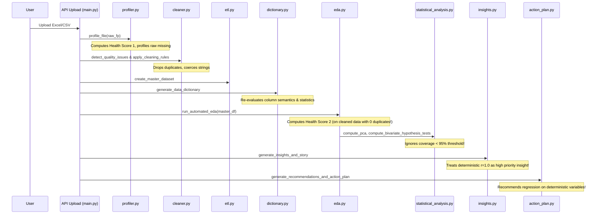

# InsightFlow AI — Comprehensive Architecture Audit Report
**Phase 1: Deep Codebase Audit, Flaw Analysis & Universal Engine Target Architecture**

---

## 1. Executive Summary & Root Cause Analysis

### The Core Problem
InsightFlow AI was previously built by patching individual symptoms across disconnected modules:
1. Data Dictionary (`dictionary.py`)
2. Profiler (`profiler.py`)
3. Data Cleaning (`cleaner.py`)
4. Automated EDA (`eda.py`)
5. Statistical Analysis (`services/statistical_analysis.py`)
6. Insights Engine (`insights.py`)
7. Recommendations & Actions (`action_plan.py`)

When different CSV/Excel datasets are uploaded, identical failure modes recur because **downstream modules independently re-interpret datasets, independently decide analytical eligibility, independently select numeric columns, calculate independent health scores, and bypass semantic classifications made upstream.**

### Root Cause Map
```
Raw Upload
    ↓
[profiler.py] ──> Calculates Health A, Profiles raw missing/nulls
    ↓
[cleaner.py]  ──> Modifies rows, drops duplicates (raw audit lost in downstream)
    ↓
[eda.py]      ──> Recalculates Health B, Re-infers semantics, Selects numeric columns ad-hoc
    ↓
[stats.py]    ──> Re-checks identifiers with regexes, runs PCA below 95% coverage threshold
    ↓
[insights.py] ──> Selects raw metrics, ignores deterministic relationships, promotes r=1.0 as strategic insight
    ↓
[action.py]   ──> Generates regression/action items on deterministic transformations
```

To permanently solve this across **any arbitrary Excel/CSV dataset**, the system must transition from symptom patching to a **Universal, Dataset-Agnostic, Governed Analytical Engine** with **one source of analytical truth**.

---

## 2. Current Backend Architecture

### Module Map
- [backend/main.py](file:///d:/Data%20Science/backend/main.py): FastAPI server, file upload parsing, project lifecycle, in-memory LRU cache (`PROJECTS_DB`), and export endpoints.
- [backend/engine/profiler.py](file:///d:/Data%20Science/backend/engine/profiler.py): 1,438 lines. Performs primary file loading and contains a monolithic 1,226-line `infer_column_semantic_metadata` function.
- [backend/engine/dictionary.py](file:///d:/Data%20Science/backend/engine/dictionary.py): 294 lines. Re-invokes `infer_column_semantic_metadata` and recalculates summary statistics.
- [backend/engine/cleaner.py](file:///d:/Data%20Science/backend/engine/cleaner.py): 360 lines. Rule detection, duplicate removal, text trimming, numeric coercion.
- [backend/engine/etl.py](file:///d:/Data%20Science/backend/engine/etl.py): 480 lines. Join detection, referential integrity check, and master dataset creation.
- [backend/engine/eda.py](file:///d:/Data%20Science/backend/engine/eda.py): 1,559 lines. Monolithic `run_automated_eda` (680 lines) that re-infers semantic layers, computes secondary health scores, runs correlation, time-series, histograms, scatter plots, boxplots, waterfall, stacked bars.
- [backend/engine/governed_engines.py](file:///d:/Data%20Science/backend/engine/governed_engines.py): 2,700+ lines. Contains classes created during past hardening attempts (`AnalyticalEligibilityEngine`, `SemanticInferenceEngine`, `KeyDetectionEngine`, `DerivedMetricEngine`, etc.), but many are bypassed or partially integrated.
- [backend/engine/analytical_truth.py](file:///d:/Data%20Science/backend/engine/analytical_truth.py): 1,227 lines. Defines `AnalyticalResult` class (not Pydantic) and helper methods like `safe_correlation`, `safe_anova`, `safe_pca_features`.
- [backend/services/statistical_analysis.py](file:///d:/Data%20Science/backend/services/statistical_analysis.py): 1,232 lines. SciPy/Scikit-learn statistical routines (PCA, Welch ANOVA, outliers, Simpson's paradox, hypothesis tests).
- [backend/engine/insights.py](file:///d:/Data%20Science/backend/engine/insights.py): 753 lines. Hardcoded insight generators for 5 categories.
- [backend/engine/action_plan.py](file:///d:/Data%20Science/backend/engine/action_plan.py): 433 lines. Generates recommendations and actions from insights.
- [backend/agents/graph.py](file:///d:/Data%20Science/backend/agents/graph.py): 600 lines. LangGraph Ask Data conversational engine.
- [backend/engine/exporter.py](file:///d:/Data%20Science/backend/engine/exporter.py): Excel and PDF reporting.

---

## 3. Current Frontend Architecture

### UI & Component Layout
- **Framework**: Next.js 16 (App Router), React 19, TypeScript, Tailwind CSS, Plotly.js ([PlotlyChartRenderer.tsx](file:///d:/Data%20Science/frontend/src/components/PlotlyChartRenderer.tsx)).
- **Primary Workspace**: [frontend/src/app/workspace/[projectId]/page.tsx](file:///d:/Data%20Science/frontend/src/app/workspace/[projectId]/page.tsx) (3,100+ lines).
- **Client API Layer**: [frontend/src/lib/api.ts](file:///d:/Data%20Science/frontend/src/lib/api.ts).
- **Workspace Tabs**:
  1. `overview`: Dataset summary cards, raw rows/cols, health score, quality issues.
  2. `dictionary`: Column table with physical dtype, semantic role, subtype, key role, unit, valid range, confidence, analytical eligibility.
  3. `eda`: Numeric and categorical summaries, correlation heatmaps, scatter plots, boxplots, waterfall, PCA projection, outliers, hypothesis testing.
  4. `visualizations`: Visualizations Studio (interactive chart selection).
  5. `insights`: Cards with observed facts, business interpretations, recommended actions, priority badges, supporting Plotly charts.
  6. `recommendations`: Strategic recommendations broken down by category, type, and impact.
  7. `action_center`: Action Center table with traceable actions, status toggle, baseline, target, owner, timeline.
  8. `ask_data`: Natural language Q&A chat.
  9. `master`: Master dataset preview (raw / cleaned / master).
  10. `reports`: Excel and PDF download triggers.

---

## 4. Current Data Flow & Critical Gaps



---

## 5. Comprehensive Audit of Duplication & Bypass Points

### A. Places Where Semantic Classification Happens Independently
1. **[backend/engine/profiler.py#L56-L1280](file:///d:/Data%20Science/backend/engine/profiler.py#L56-L1280)**: Monolithic `infer_column_semantic_metadata` infers roles, subtypes, units, ranges, and eligibility.
2. **[backend/engine/governed_engines.py#L220-L460](file:///d:/Data%20Science/backend/engine/governed_engines.py#L220-L460)**: `SemanticInferenceEngine.infer_column` classifies tokens and returns `SemanticFieldProfile`.
3. **[backend/engine/eda.py#L890](file:///d:/Data%20Science/backend/engine/eda.py#L890)**: Re-runs `infer_column_semantic_metadata` for every column, overriding project-level definitions.
4. **[backend/engine/dictionary.py#L32](file:///d:/Data%20Science/backend/engine/dictionary.py#L32)**: Re-runs `infer_column_semantic_metadata` on the master DataFrame.
5. **[backend/engine/semantic.py#L30-L73](file:///d:/Data%20Science/backend/engine/semantic.py#L30-L73)**: `SemanticLayer._build_indexes` re-interprets roles with fallback heuristics (e.g. `if "int" in dtype_str: measures.append(...)`).
6. **[backend/services/statistical_analysis.py#L352-L402](file:///d:/Data%20Science/backend/services/statistical_analysis.py#L352-L402)**: Re-evaluates column names via keywords if `sem_layer` is missing or incomplete.

### B. Places Where Numeric Columns Are Selected Independently
1. **[backend/engine/cleaner.py#L61](file:///d:/Data%20Science/backend/engine/cleaner.py#L61)**: `select_dtypes(include=['object', 'string'])` with regex stripping.
2. **[backend/engine/eda.py#L892](file:///d:/Data%20Science/backend/engine/eda.py#L892)**:
   ```python
   measures = [c for c, m in sem_layer.items() if m.get("is_measure") and not m.get("is_identifier")]
   ```
3. **[backend/engine/eda.py#L917](file:///d:/Data%20Science/backend/engine/eda.py#L917)**: Iterates over `measures` for numeric summaries **without checking `analytical_eligible`!**
4. **[backend/engine/eda.py#L1105](file:///d:/Data%20Science/backend/engine/eda.py#L1105)**: Subsets `df[eligible_measures]`.
5. **[backend/engine/dictionary.py#L51](file:///d:/Data%20Science/backend/engine/dictionary.py#L51)**: `is_num = (pd.api.types.is_numeric_dtype(series) or meta.get("is_measure", False)) and not meta.get("is_identifier", False)`.
6. **[backend/services/statistical_analysis.py#L356](file:///d:/Data%20Science/backend/services/statistical_analysis.py#L356)**: Re-filters `pd.api.types.is_numeric_dtype(df[c])`.
7. **[backend/services/statistical_analysis.py#L560](file:///d:/Data%20Science/backend/services/statistical_analysis.py#L560)**: Outliers engine filters by numeric dtype.

### C. Places Where DataFrames Are Independently Created
1. `backend/main.py`: `dfs_dict`, `cleaned_dfs_dict`, `master_df`, `raw_df`.
2. `backend/engine/eda.py#L1105`: `measures_df = df[eligible_measures].apply(...)`.
3. `backend/engine/eda.py#L1191`: `t_df = df[[date_col, m_col]].copy()`.
4. `backend/engine/eda.py#L1468`: `valid = pd.DataFrame({c1: s1, c2: s2}).dropna()`.
5. `backend/services/statistical_analysis.py#L416`: `clean_df = df[num_cols].dropna()`.
6. `backend/engine/analytical_truth.py`: Creates temporary DataFrames for grouped aggregations.

### D. Places Where Insights, Recommendations, and Actions Are Generated
1. **Insights**: [backend/engine/insights.py#L107-L550](file:///d:/Data%20Science/backend/engine/insights.py#L107-L550) creates 5 hardcoded insight blocks. Correlation insights are generated purely if `abs(r) >= 0.4`, completely unaware if $Y$ is a deterministic transformation of $X$ ($r = 1.0$).
2. **Recommendations**: [backend/engine/action_plan.py#L84-L260](file:///d:/Data%20Science/backend/engine/action_plan.py#L84-L260) generates recommendations based on insight titles and keywords. If an insight mentions correlation, it proposes bivariate regression even on deterministic formulas.
3. **Actions**: [backend/engine/action_plan.py#L261-L380](file:///d:/Data%20Science/backend/engine/action_plan.py#L261-L380) constructs action items.

---

## 6. Conflicting Logic & Inconsistencies Discovered

| Issue | Current Behavior | Target Behavior (Section Required) |
|---|---|---|
| **Dataset Health Divergence** | Profiler calculates health on raw data (e.g. 95.4); EDA calculates health on cleaned data (e.g. 99.2). | **Single DatasetHealthResult** consumed by all modules (Section 10). |
| **Duplicate Count Visibility** | Raw dataset has 4 duplicates; after cleaning, EDA reports `total_duplicates: 0`. | Both `raw_duplicate_count: 4` and `cleaned_duplicate_count: 0` remain visible (Section 9). |
| **PCA Coverage Threshold** | PCA runs if effective observations $> 30$ and pct $> 30\%$. Below 95% coverage, it still runs silently. | Primary PCA requires $\ge 95\%$ coverage. If $< 95\%$, return `NOT_APPLICABLE` (Section 12, 18). |
| **Deterministic Transformations** | $Risk\_Index\_Pct = Risk\_Score \times 4$ gets Pearson $r = 1.0$, is promoted as a "Strong Strategic Association", and generates "Bivariate Regression" recommendations. | Tagged as `DETERMINISTIC_TRANSFORMATION` / `STRUCTURAL_RELATIONSHIP`. Blocked from strategic insights, redundant PCA, and regression recommendations (Sections 15, 16, 28, 31). |
| **Constant Variables** | Constant columns (e.g. `Observation_Count` with all 1s) risk being called a Dimension or entering statistics. | `variance <= 1e-9` or `nunique <= 1` $\to$ `CONSTANT` $\to$ blocked from correlation, PCA, ANOVA, Kruskal, distribution (Section 14). Semantic role remains Measure/Count (Section 5). |
| **Test Fixtures** | Columns like `Relationship_Test_*` enter correlations and PCA if numeric. | Automatically detected and flagged `exclusion_reason = "TEST_FIXTURE"`, blocked from primary EDA (Section 13). |
| **Lack of Pydantic Contracts** | Schemas are loose Python dicts with duck-typed properties. | Strict Pydantic models: `DatasetContract`, `ColumnSemanticContract`, `AnalyticalResult` (Sections 4, 5, 26). |

---

## 7. Proposed Target Architecture

```mermaid
flowchart TD

    A[Excel / CSV / Parquet Upload]
        --> B[Ingestion Engine]

    B --> C[DatasetContract (Pydantic)]
    B --> D[Raw Dataset Store]

    C --> E[Schema & Profiling Engine]
    E --> F[Semantic Data Dictionary]

    F --> G[Data Quality Engine]
    G --> H[Cleaning / Normalization Engine]

    F --> I[Analytical Eligibility Engine]
    G --> I
    H --> I

    I --> J[Derivation & Lineage Engine]

    J --> K[Canonical Analytical Dataset]

    K --> L1[Descriptive Statistics Engine]
    K --> L2[Correlation Engine]
    K --> L3[ANOVA Engine]
    K --> L4[Kruskal-Wallis Engine]
    K --> L5[PCA Engine]
    K --> L6[Outlier Engine]
    K --> L7[Temporal Engine]
    K --> L8[Distribution Engine]
    K --> L9[Composition Engine]

    L1 --> M[Canonical AnalyticalResult Store]
    L2 --> M
    L3 --> M
    L4 --> M
    L5 --> M
    L6 --> M
    L7 --> M
    L8 --> M
    L9 --> M

    M --> N[Insight Eligibility Engine]
    N --> O[Insight Generator]

    O --> P[Recommendation Rule Engine]
    P --> Q[Recommendation Generator]

    Q --> R[Action Engine]
    R --> S[Action Center]

    M --> T[Visualization Engine]
    T --> U[Visualizations Studio]

    M --> V[Export Engine]
    V --> W[Excel / PDF Reports]

    O --> X[LLM / LangGraph]
    Q --> X
    X --> O
    X --> Q
```

---

## 8. Canonical Pydantic Contracts Specification

### Contract 1: `DatasetContract` ([backend/engine/contracts/dataset_contract.py](file:///d:/Data%20Science/backend/engine/contracts/dataset_contract.py))
```python
class DatasetContract(BaseModel):
    dataset_id: str
    source_file_name: str
    source_file_hash: str
    source_format: str
    source_table: Optional[str] = None
    ingestion_timestamp: str
    raw_row_count: int
    raw_column_count: int
    cleaned_row_count: int
    analytical_row_count: int
    raw_duplicate_count: int
    cleaned_duplicate_count: int
    schema_version: str = "2.0.0"
    columns: Dict[str, ColumnSemanticContract]
    relationships: List[Dict[str, Any]] = []
    derivations: List[DerivationContract] = []
    quality_result: Dict[str, Any] = {}
    analytical_eligibility_result: Dict[str, Any] = {}
    dataset_health_result: DatasetHealthResult
```

### Contract 2: `ColumnSemanticContract` ([backend/engine/contracts/column_contract.py](file:///d:/Data%20Science/backend/engine/contracts/column_contract.py))
```python
class ColumnSemanticContract(BaseModel):
    # Identity
    column_name: str
    source_table: str
    source_column: str
    physical_dtype: str

    # Semantics
    semantic_role: SemanticRoleEnum        # IDENTIFIER, DIMENSION, DATETIME, MEASURE, TEXT, BOOLEAN
    semantic_subtype: str
    measure_type: Optional[MeasureTypeEnum] # COUNT, CURRENCY, PERCENTAGE, DURATION, RATING, SCORE_INDEX, ORDINAL, CONTINUOUS, DISCRETE
    unit: Optional[str] = None
    currency: Optional[str] = None
    rating_scale: Optional[str] = None
    ordinal: bool = False
    boolean_semantics: bool = False

    # Keys & Relationships
    key_role: KeyRoleEnum                  # PRIMARY_KEY, FOREIGN_KEY, CANDIDATE_FK, NONE
    id_safety: bool = False
    uniqueness_pct: float
    null_pct: float
    candidate_parent: Optional[str] = None
    relationship_status: str = "UNVERIFIED"

    # Analytical Eligibility
    analytical_eligible: bool
    exclusion_reason: Optional[str] = None # CONSTANT, TEST_FIXTURE, IDENTIFIER, LOW_COVERAGE, etc.
    grouping_eligible: bool = False
    time_series_eligible: bool = False
    correlation_eligible: bool = False
    pca_eligible: bool = False
    anova_eligible: bool = False
    kruskal_eligible: bool = False
    visualization_eligible: bool = False

    # Statistics
    non_null_count: int
    missing_count: int
    missing_pct: float
    coverage_pct: float
    unique_count: int
    cardinality_pct: float
    variance: Optional[float] = None
    min: Optional[float] = None
    max: Optional[float] = None
    mean: Optional[float] = None
    median: Optional[float] = None

    # Lineage
    derivation_type: DerivationTypeEnum = DerivationTypeEnum.OBSERVED
    derived_from: List[str] = []
    derivation_formula: Optional[str] = None
    transformation_type: Optional[str] = None

    # Evidence
    confidence: float
    evidence: List[str] = []
    semantic_evidence: Dict[str, Any] = {}
```

### Contract 3: `AnalyticalResult` ([backend/engine/contracts/analytical_result.py](file:///d:/Data%20Science/backend/engine/contracts/analytical_result.py))
```python
class AnalyticalResult(BaseModel):
    analytical_result_id: str             # AR-000001
    dataset_id: str
    analysis_type: str                    # CORRELATION, PCA, ANOVA, KRUSKAL, DESCRIPTIVE, TEMPORAL, OUTLIER, etc.
    status: AnalysisStatusEnum            # PASS, WARNING, NOT_APPLICABLE, INSUFFICIENT_DATA, BLOCKED, ERROR
    source_columns: List[str]
    source_table: str
    method: str
    parameters: Dict[str, Any] = {}
    sample: Dict[str, Any] = {}
    metrics: Dict[str, Any] = {}
    effect_size: Dict[str, Any] = {}
    assumptions: Dict[str, Any] = {}
    coverage: Dict[str, Any] = {}
    relationship_type: str = "INDEPENDENT" # INDEPENDENT, DETERMINISTIC_TRANSFORMATION, STRUCTURAL_RELATIONSHIP
    derivation_status: str = "OBSERVED"
    evidence: Dict[str, Any] = {}
    interpretation_status: str = "VERIFIED"
    chart_spec: Optional[Dict[str, Any]] = None
    takeaway: str = ""
    interpretation: str = ""
    recommendation_eligibility: bool = True
```

---

## 9. Exact Files Impact Assessment

### Files to Keep Unchanged
- `backend/agents/graph.py` (LangGraph already operates downstream on verified data)
- `frontend/src/components/PlotlyChartRenderer.tsx` (already supports standard Plotly specs)
- `frontend/src/app/layout.tsx`, `globals.css`

### New Files to Create
1. `backend/engine/contracts/__init__.py`
2. `backend/engine/contracts/dataset_contract.py` (Pydantic `DatasetContract`)
3. `backend/engine/contracts/column_contract.py` (Pydantic `ColumnSemanticContract` and enums)
4. `backend/engine/contracts/analytical_result.py` (Pydantic `AnalyticalResult`)
5. `backend/engine/lineage_derivation.py` (Comprehensive Derivation & Lineage Engine: $A=B\times C$, $A=B/C$, $A=B+C$, $A=B\times k$, percentage transformations, structural relationship classifier)
6. `backend/engine/canonical_eligibility.py` (Centralized Analytical Eligibility Engine)
7. `backend/tests/test_universal_dataset_matrix.py` (Automated regression suite for 16 datasets A through P)

### Existing Files to Modify / Refactor
1. [backend/engine/governed_engines.py](file:///d:/Data%20Science/backend/engine/governed_engines.py): Standardize with Pydantic contracts and connect with centralized derivation/lineage.
2. [backend/engine/profiler.py](file:///d:/Data%20Science/backend/engine/profiler.py): Refactor to populate canonical `ColumnSemanticContract` and use single `DatasetHealthResult`.
3. [backend/engine/dictionary.py](file:///d:/Data%20Science/backend/engine/dictionary.py): Consume canonical column contracts instead of independently recalculating statistics.
4. [backend/engine/cleaner.py](file:///d:/Data%20Science/backend/engine/cleaner.py): Preserve raw vs cleaned row/duplicate counts in the dataset contract.
5. [backend/engine/eda.py](file:///d:/Data%20Science/backend/engine/eda.py): Refactor `run_automated_eda` to consume canonical eligibility, block `TEST_FIXTURE` and `CONSTANT`, tag deterministic relationships, and generate `AnalyticalResult` objects.
6. [backend/services/statistical_analysis.py](file:///d:/Data%20Science/backend/services/statistical_analysis.py): Enforce 95% coverage threshold for PCA (`NOT_APPLICABLE`), exclude redundant derived variables, format ANOVA/Kruskal with adjusted p-values.
7. [backend/engine/insights.py](file:///d:/Data%20Science/backend/engine/insights.py): Consume `AnalyticalResult` via Insight Eligibility Engine, block deterministic transformations from strategic priority, require numerical evidence.
8. [backend/engine/action_plan.py](file:///d:/Data%20Science/backend/engine/action_plan.py): Generate recommendations strictly from verified insights, map deterministic relationships to `ANALYTICAL_GOVERNANCE`, ensure end-to-end lineage ($Dataset \to AR \to Insight \to Rec \to Action$).
9. [backend/main.py](file:///d:/Data%20Science/backend/main.py): Wire the unified pipeline so upload immediately constructs `DatasetContract` and propagates it downstream.
10. [frontend/src/app/workspace/[projectId]/page.tsx](file:///d:/Data%20Science/frontend/src/app/workspace/[projectId]/page.tsx): Ensure all tabs seamlessly bind to the canonical contracts and display analytical results, lineage, and exclusion reasons cleanly.

---

## 10. Phased Implementation Plan

| Phase | Description | Deliverable / Acceptance Check |
|---|---|---|
| **Phase 1** | Codebase Audit & Target Architecture Review | Architecture Audit Report completed & presented for approval. |
| **Phase 2 & 3** | Canonical Pydantic Contracts | `DatasetContract`, `ColumnSemanticContract`, `DatasetHealthResult`. |
| **Phase 4 & 5** | Profiling, Semantics & Central Health | Single `DatasetHealthResult`, no health discrepancies. |
| **Phase 6** | Centralized Analytical Eligibility Engine | All tests for `TEST_FIXTURE`, `CONSTANT`, coverage filtering pass. |
| **Phase 7** | Derivation & Lineage Engine | Mathematical detection of linear, multiplicative, and percentage transforms. |
| **Phase 8 & 9** | Canonical `AnalyticalResult` & Governed EDA | Correlation, ANOVA, Kruskal, Outliers, Temporal all produce `AnalyticalResult`. |
| **Phase 10 & 11** | Governed PCA & Visualizations | 95% coverage threshold enforced, deterministic redundancies excluded. |
| **Phase 12 & 13** | Governed Insights, Recommendations & Actions | Deterministic relationships classified as governance; full lineage ($AR \to Action$). |
| **Phase 14 & 15** | Universal Test Fixtures (A through P) | 16 diverse datasets validate dataset-agnostic governance. |
| **Phase 16** | End-to-End Regression & Production Build | 352 existing tests pass + new test matrix passes + frontend build passes. |
