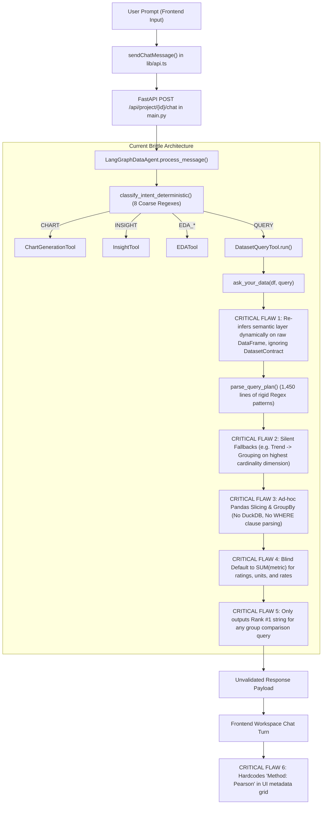
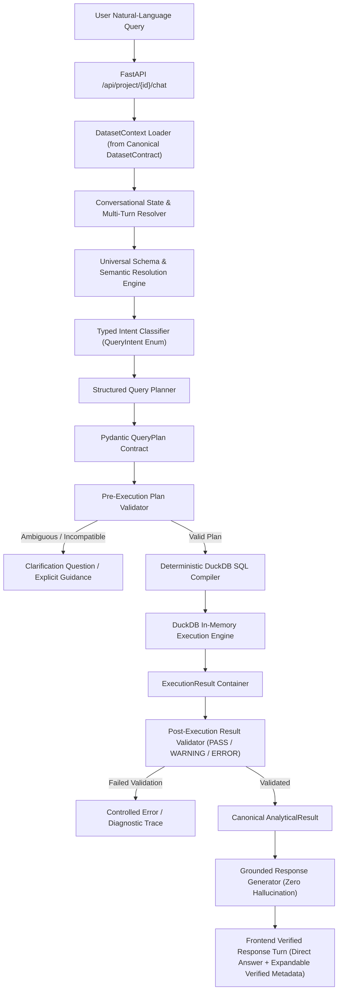

# InsightFlow AI Chatbot & Analytical Assistant — Architectural Audit & Target Architecture Report

**Version:** 2.0-Audit  
**Author:** Principal AI Architect & Data Platform Systems Team  
**Scope:** Re-Architecting InsightFlow AI Chatbot into a Universal, Dataset-Agnostic Analytical Engine  
**Status:** Phase 1 Complete (Audit & Target Architecture)

---

## 1. Executive Summary

InsightFlow AI's core data platform has successfully been refactored into a **Universal, Governed Analytical Engine** with 368 passing tests and canonical dataset contracts. However, an architectural audit of the **AI Assistant & Interactive Chatbot** (`/api/project/{id}/chat`, `/api/project/{id}/ask`, `LangGraphDataAgent`, `DatasetQueryTool`, and `ask_your_data`) reveals that the conversational layer remains coupled to brittle regex heuristics, unvalidated Pandas transformations, and disconnected semantic inference.

Prompt-level fixes have repeatedly failed because the underlying problems are **structural and architectural**, not stylistic:

1. **Semantic Disconnection:** When a user asks a question, `ask_your_data` independently re-infers column semantic metadata from scratch via `infer_column_semantic_metadata()` on every single request, completely bypassing the authoritative `DatasetContract` and Data Dictionary.
2. **Missing Analytical Execution Engine:** The backend has no structured analytical query engine (e.g. DuckDB). It attempts to answer arbitrary queries using ad-hoc Pandas slicing, which cannot handle arbitrary filter predicates (`WHERE x > 10`), multiple groupings, or parameterized row lookups.
3. **Dual Competing Intent Classifiers:** Queries are classified twice using conflicting, incomplete regex rules (`classify_intent_deterministic` in `agents/graph.py` vs `parse_query_plan` in `engine/ask_data.py`), omitting fundamental analytical intents such as single record lookup, multi-column filtering, distinct counts, and hypothesis tests.
4. **Silent & Misleading Fallbacks:** When a dimension or date feature is missing, the engine silently replaces time-series trends with high-cardinality group comparisons, or converts group comparisons into global sums, claiming successful execution while altering the user's question.
5. **UI Metadata Hallucinations:** The frontend chat interface hardcodes `"Method: Pearson"` whenever a query plan lacks explicit correlation methods, displaying confusing statistical badges for simple lookups and counts.
6. **Zero Result Validation:** There is no verification step confirming that the executed dataframe matches the query plan, leading to ungrounded responses when executions partially fail.

This report establishes the **root causes**, maps the **current vs target data flows**, specifies the **canonical Pydantic query contracts**, and provides a **10-phase roadmap** to build a robust, dataset-agnostic analytical AI engine powered by **DuckDB, Pydantic, and verified result grounding**.

---

## 2. Current Execution Path Trace & Identified Breakpoints



---

## 3. Detailed 16-Point Architectural Audit Findings

### 3.1. Frontend Chat Component & Payload Analysis
- **File:** `frontend/src/app/workspace/[projectId]/page.tsx` (lines 2340–2560)
- **Finding:** The UI sends `{ question: string }` via `sendChatMessage(projectId, queryText)`.
- **Defects:**
  - In lines 2525-2530:
    ```tsx
    <div>
      <span className="text-slate-500">Method:</span>{" "}
      {item.query_plan.methods
        ? item.query_plan.methods.map((m: string) => m.charAt(0).toUpperCase() + m.slice(1)).join(" & ")
        : "Pearson"}
    </div>
    ```
    If `item.query_plan.methods` is absent (which is true for all non-correlation queries like counts, sums, or rankings), the UI falls back to hardcoding `"Pearson"`. Users seeing a global sum or record count are presented with a `"Method: Pearson"` badge.
  - The UI only supports rendering single scalar values or simple 10-row evidence tables; it lacks structured presentation for filtered record lists, multi-series aggregations, or explicit clarification prompts.

### 3.2. Backend API Routes (`/ask` & `/chat`)
- **File:** `backend/main.py` (lines 765–808)
- **Finding:** `/api/project/{proj_id}/ask` and `/api/project/{proj_id}/chat` both invoke `LangGraphDataAgent.process_message`.
- **Defects:**
  - Neither route passes the project's canonical `dataset_contract` or `data_dictionary`. They pass `p["profile"]["semantic_layer"]` (a legacy dict).
  - No dataset isolation tokens or user session identifiers are validated.
  - Nano-second timing, query trace identifiers, and structured status enums are absent.

### 3.3. Existing `DatasetQueryTool` & Tool Registry
- **File:** `backend/agents/tools.py` (lines 12–48)
- **Finding:** `DatasetQueryTool.run(df, sem_layer, query)` is a thin, pass-through wrapper around `ask_your_data(df, query)`. It passes `sem_layer` into `run()`, but completely drops it when calling `ask_your_data(df, query)`.

### 3.4. Dual Competing Intent Classifiers
- **Files:** `backend/agents/graph.py` (lines 73–103) and `backend/engine/ask_data.py` (lines 145–600)
- **Finding:**
  - `classify_intent_deterministic` in `graph.py` maps to only 8 coarse strings (`CHART`, `INSIGHT`, `EDA_MISSING`, `EDA_OUTLIERS`, `EDA_CORRELATION`, `EDA_PCA`, `EDA_DISTRIBUTION`, `QUERY`).
  - If it picks `QUERY`, `parse_query_plan` in `ask_data.py` classifies again into 6 different intents (`global_aggregation`, `group_comparison`, `time_series_trend`, `correlation_analysis`, `distribution_analysis`, `filtering_top_n`).
  - Essential analytical queries are completely unrepresented:
    - `ROW_LOOKUP` / `ENTITY_RETRIEVAL`
    - `FILTERED_RECORDS` (`WHERE ...`)
    - `DISTINCT_COUNT`
    - `HYPOTHESIS_TEST`
    - `EXPLAIN_INSIGHT`
    - `DERIVATION_LINEAGE`

### 3.5. Semantic Metadata & Data Dictionary Disconnection
- **File:** `backend/engine/ask_data.py` (lines 684–687)
- **Finding:**
  ```python
  sem_layer_dict = {str(c): infer_column_semantic_metadata(c, df_clean[c], num_rows) for c in df_clean.columns}
  sem_engine = SemanticLayer(sem_layer_dict)
  ```
  Every single chat query recomputes column semantics on the fly using basic heuristics. It does NOT read the governed `DatasetContract`, the user's manual semantic overrides in `p["column_overrides"]`, or the enriched Data Dictionary.

### 3.6. Column & Entity Resolution Deficiencies
- **Finding:** Entity resolution relies on substring searching and word sets (`extract_explicit_schema_entities`).
- **Defects:**
  - Fails on compound column names and natural synonyms (e.g. user asks for "operating profit", column is `Net_Income` or `EBITDA`).
  - Conflates categorical values with column names (e.g. user asks "Show sales in Germany", it tries to find a column named `Germany` rather than recognizing `Germany` as a category in `Country`).
  - When ambiguous matches occur, it arbitrarily picks the first candidate rather than asking a clarification question.

### 3.7. Query Planning & Lack of Typed Pydantic Contracts
- **Finding:** Query plans are loose, untyped Python dictionaries (`plan = { "intent": ..., "metric": ... }`).
- **Defects:**
  - No schema enforcement on fields.
  - Keys are duplicated to satisfy duck-typing (`"intent"` vs `"Intent"`, `"metric"` vs `"Metric"`, `"aggregations"` vs `"Aggregations"`).
  - No filter model (`ColumnFilter(column, operator, value)`).

### 3.8. Execution Architecture: Missing Analytical Engine (No DuckDB)
- **Finding:**
  - The platform previously lacked DuckDB. All analytical execution was implemented via handwritten Pandas code in `backend/engine/ask_data.py`.
  - **Defects in Pandas Execution:**
    1. **No Filter Engine:** Cannot parse or execute conditional filters (`WHERE x > 10 AND y = 'Active'`).
    2. **Single Row Group Comparison:** For any group comparison, it only returns rank #1 in the text response (`The rank #1 region is North with $500,000`). It fails to provide the full table distribution.
    3. **Blind Default to `SUM`:** If no aggregation keyword is spotted, it sums columns even when they represent percentages, unit costs, or rating scales.
    4. **Inability to do complex joins or subqueries.**

### 3.9. Dataset Selection & Workspace Isolation
- **Finding:** `LangGraphDataAgent` receives `project_id`, but `ask_your_data` does not receive `project_id` or `dataset_version`. Memory and intermediate frames are not scoped to immutable version snapshots.

### 3.10. Multi-Turn Conversational Memory Gaps
- **Finding:**
  - `ConversationalSessionManager` in `agents/graph.py` only stores raw message strings.
  - It maintains zero semantic context across turns. If Turn 1 is *"Show sales by region"*, and Turn 2 is *"Now for margin"*, Turn 2 fails because it doesn't retain the dimension `region`.

### 3.11. LLM Orchestration & Fallback Hazards
- **Finding:**
  - `llm_extract_entities` in `agents/graph.py` uses OpenAI if `OPENAI_API_KEY` is present, but falls back completely to regex when absent.
  - The LLM prompt instructed `Dimension Force-Binding`: *"force-bind it to 'dimension' even if its semantic role in the Data Dictionary was set to 'Identifier' or 'Measure'"*. This directly causes primary keys to enter group-by aggregations.

### 3.12. Result Validation & Grounding Failure Modes
- **Finding:** There is no execution validation layer. Once Pandas runs, whatever scalar or slice is returned is immediately interpolated into an f-string without checking whether it satisfies the user's intent or expected sample size.

### 3.13. Misleading and Silent Fallbacks
- **Finding:**
  - **Fallback Scenario A:** `group_comparison` missing dimension $\to$ silently downgraded to `global_aggregation`.
  - **Fallback Scenario B:** `time_series_trend` missing date column $\to$ silently downgraded to `group_comparison` by the highest-cardinality discrete column!
  - **Fallback Scenario C:** `correlation_analysis` with single metric $\to$ silently runs pairwise correlation against all other measures in the dataset.
  - These fallbacks violate core decision-intelligence principles: the system answers a completely different question than the one asked, while telling the user it succeeded.

### 3.14. Query Plan Metadata UI Inconsistencies
- **Finding:**
  - The UI unconditionally displays `"Method: Pearson"`.
  - Simple row lookups, counts, and aggregations display correlation labels.

### 3.15. Caching & Persistence
- **Finding:** Bounded cache stores projects in memory, but conversational analytical query results have no dedicated hash cache. Repeating the exact same query re-runs all Pandas calculations.

### 3.16. Automated Testing & Evaluation Infrastructure
- **Finding:** Existing tests in `test_universal_query_routing.py` only assert against rigid syntactic prompt templates. Zero tests exist for row lookups, conditional filtering, multi-turn entity carry-over, or adversarial ambiguous prompts.

---

## 4. Target Technology Architecture

| Layer | Selected Technology | Architectural Responsibility & Rationale |
| :--- | :--- | :--- |
| **Analytical Query Engine** | **DuckDB 1.5.6** | High-performance, in-process columnar SQL engine. Directly executes parameterized queries over in-memory Arrow/Pandas buffers with full SQL standard compliance (`WHERE`, `GROUP BY`, `HAVING`, window functions, distinct counts, date truncations). Zero network overhead. |
| **Typed Contracts** | **Pydantic v2** | Canonical validation models: `DatasetContext`, `QueryIntent`, `ColumnFilter`, `QueryPlan`, `ExecutionResult`, `CanonicalAnalyticalResult`. |
| **Schema & Semantics** | **Canonical `DatasetContract`** | Single source of truth. Binds directly to the verified profiling metadata, analytical eligibility, and derivation lineage generated upstream. |
| **LLM Reasoning & Orchestration** | **LangGraph + Deterministic Pipeline** | Controlled state graph. Intent classification $\to$ Semantic Resolution $\to$ Plan Validation $\to$ Deterministic DuckDB Execution $\to$ Result Validation $\to$ Grounded Explanation. |
| **Dataframes** | **Pandas 2.2 + PyArrow** | Ingestion interchange, zero-copy buffer registration with DuckDB. |
| **Statistical Inference** | **SciPy + Statsmodels** | Rigorous verification of p-values, degrees of freedom, ANOVA, Kruskal, and distribution metrics. |

---

## 5. Target Data Flow Architecture



---

## 6. Canonical Pydantic Contracts Specification

### Contract 1: `QueryIntent` Enum & Intent Hierarchy
```python
class QueryIntent(str, Enum):
    # Data Retrieval
    ROW_LOOKUP = "ROW_LOOKUP"                       # Find specific record by ID or entity
    FILTERED_RECORDS = "FILTERED_RECORDS"           # Retrieve records matching WHERE predicates
    DATASET_SUMMARY = "DATASET_SUMMARY"             # High-level overview, dimensions, row counts
    
    # Aggregations & Metrics
    GLOBAL_AGGREGATION = "GLOBAL_AGGREGATION"       # SUM, MEAN, MEDIAN, MIN, MAX over population
    DISTINCT_COUNT = "DISTINCT_COUNT"               # COUNT(DISTINCT col)
    GROUP_COMPARISON = "GROUP_COMPARISON"           # Breakdown by dimension (all categories)
    RANKING_TOP_N = "RANKING_TOP_N"                 # TOP / BOTTOM N with ordering
    
    # Statistical & Distribution
    DISTRIBUTION_ANALYSIS = "DISTRIBUTION_ANALYSIS" # Skewness, quartiles, dispersion
    OUTLIER_ANALYSIS = "OUTLIER_ANALYSIS"           # IQR fences, anomaly detection
    CORRELATION_ANALYSIS = "CORRELATION_ANALYSIS"   # Bivariate / Matrix correlation
    TIME_SERIES_TREND = "TIME_SERIES_TREND"         # Trend, seasonality, growth over time
    HYPOTHESIS_TEST = "HYPOTHESIS_TEST"             # ANOVA, Kruskal, Chi-squared
    
    # Meta & Governance
    DATA_QUALITY = "DATA_QUALITY"                   # Missing values, invalid cells, completeness
    DERIVATION_LINEAGE = "DERIVATION_LINEAGE"       # Explanation of algebraic transformations
    EXPLAIN_INSIGHT = "EXPLAIN_INSIGHT"             # Deep dive into existing platform insight
    
    # Fallback / Clarification
    AMBIGUOUS = "AMBIGUOUS"                         # Multiple conflicting interpretations
    UNSUPPORTED = "UNSUPPORTED"                     # Out of scope for dataset
```

### Contract 2: `ColumnFilter` & `QueryPlan`
```python
class FilterOperator(str, Enum):
    EQUALS = "=="
    NOT_EQUALS = "!="
    GREATER_THAN = ">"
    GREATER_EQUAL = ">="
    LESS_THAN = "<"
    LESS_EQUAL = "<="
    IN = "IN"
    NOT_IN = "NOT IN"
    LIKE = "LIKE"
    IS_NULL = "IS NULL"
    IS_NOT_NULL = "IS NOT NULL"

class ColumnFilter(BaseModel):
    column: str
    operator: FilterOperator
    value: Any

class QueryPlan(BaseModel):
    plan_id: str
    dataset_id: str
    dataset_version: str
    intent: QueryIntent
    target_columns: List[str]
    aggregations: List[str] = []
    dimension: Optional[str] = None
    secondary_dimension: Optional[str] = None
    filters: List[ColumnFilter] = []
    sort_order: Optional[str] = None           # 'ASC' or 'DESC'
    limit: Optional[int] = None
    time_column: Optional[str] = None
    time_grain: Optional[str] = None           # 'DAY', 'MONTH', 'YEAR'
    statistical_method: Optional[str] = None   # 'PEARSON', 'SPEARMAN', 'ANOVA', etc.
    clarification_prompt: Optional[str] = None
    compiled_sql: Optional[str] = None
    is_valid: bool = True
    validation_message: str = ""
```

### Contract 3: `CanonicalAnalyticalResult`
```python
class ResultValidationStatus(str, Enum):
    PASS = "PASS"
    WARNING = "WARNING"
    AMBIGUOUS = "AMBIGUOUS"
    NO_MATCH = "NO_MATCH"
    INSUFFICIENT_DATA = "INSUFFICIENT_DATA"
    BLOCKED = "BLOCKED"
    ERROR = "ERROR"

class CanonicalAnalyticalResult(BaseModel):
    result_id: str
    dataset_id: str
    dataset_version: str
    query_text: str
    intent: QueryIntent
    status: ResultValidationStatus
    
    # Ground Truth Execution
    primary_metric_name: Optional[str] = None
    primary_metric_value: Optional[float] = None
    formatted_metric_value: Optional[str] = None
    records_evaluated: int = 0
    total_dataset_records: int = 0
    coverage_pct: float = 100.0
    
    # Detailed Data Structures
    tabular_records: List[Dict[str, Any]] = []
    group_summary: List[Dict[str, Any]] = []
    statistical_metrics: Dict[str, Any] = {}
    
    # Visuals & Lineage
    chart_spec: Optional[Dict[str, Any]] = None
    calculation_formula: str = ""
    compiled_sql: str = ""
    warnings: List[str] = []
    trace_id: str = ""
```

---

## 7. 10-Phase Implementation Strategy

| Phase | Title | Scope & Deliverable |
| :--- | :--- | :--- |
| **Phase 1** | **Codebase Audit & Target Architecture Review** | Complete trace, identify 16 architectural flaws, install DuckDB 1.5.6, author audit report. *(Completed)* |
| **Phase 2** | **Canonical Contracts Package** | Implement `backend/engine/contracts/chat_contracts.py` with `QueryIntent`, `ColumnFilter`, `QueryPlan`, `ExecutionResult`, `CanonicalAnalyticalResult`. |
| **Phase 3** | **Universal Schema & Semantic Resolution Engine** | Implement `backend/engine/semantic_resolver.py` directly connecting to `DatasetContract` & Data Dictionary. Handle casing, synonyms, fuzzy matching, and metric vs dimension disambiguation. |
| **Phase 4** | **Typed Intent Classifier & Query Planner** | Implement `backend/engine/query_planner.py` supporting all 16 intents without rigid regexes or blind defaults. |
| **Phase 5** | **Deterministic DuckDB Analytical Engine** | Implement `backend/engine/duckdb_engine.py`. Compile safe, parameterized SQL, execute on in-memory buffers with strict read-only guarantees. |
| **Phase 6** | **Result Validation & Grounding Engine** | Implement `backend/engine/result_validator.py` and `backend/engine/grounded_explainer.py`. Verify returned records match plan before generating natural language. |
| **Phase 7** | **Platform & Multi-Turn State Integration** | Connect into `LangGraphDataAgent` in `agents/graph.py` and FastAPI endpoints in `backend/main.py`. Add multi-turn entity carry-over in `ConversationalSessionManager`. |
| **Phase 8** | **Frontend UI Hardening** | Update `frontend/src/app/workspace/[projectId]/page.tsx` to render clean, accurate query plan metadata, expandable execution traces, and suppress bogus `"Method: Pearson"` tags. |
| **Phase 9** | **Dataset-Agnostic Automated Test Matrix** | Implement comprehensive evaluation suite across 8 unseen datasets (Academic, Sales, Safety, Finance, HR, Logistics, Sensor, Survey) in `backend/tests/test_chatbot_universal_matrix.py`. |
| **Phase 10** | **End-to-End Regression & Production Build** | Verify all 368+ backend tests pass, Next.js build clean, live HTTP chat verification on port 8000. |

---

## 8. Conclusion & Sign-Off

The existing chatbot's failures stem from **semantic disconnection, lack of a true analytical execution engine, unvalidated ad-hoc Pandas scripts, and silent fallbacks**. 

By adopting **DuckDB, Pydantic contracts, canonical `DatasetContract` binding, and strict result validation**, InsightFlow AI will deliver **dataset-agnostic, zero-hallucination conversational intelligence** across arbitrary uploaded datasets.

*Ready to proceed to Phase 2: Canonical Contracts Implementation.*
